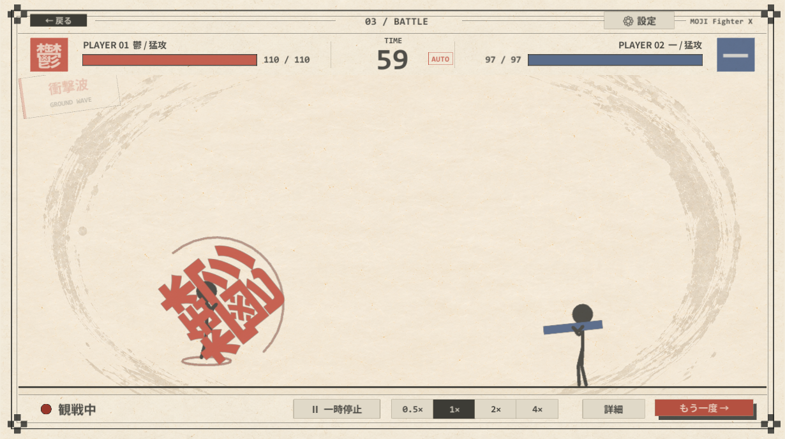
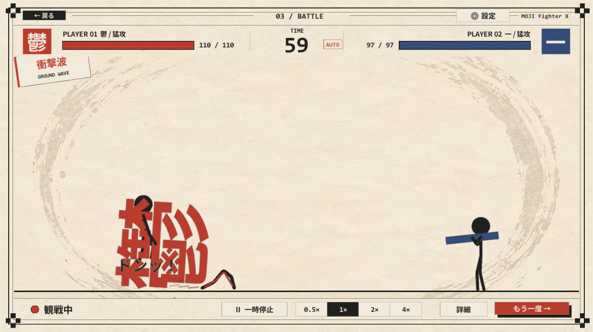
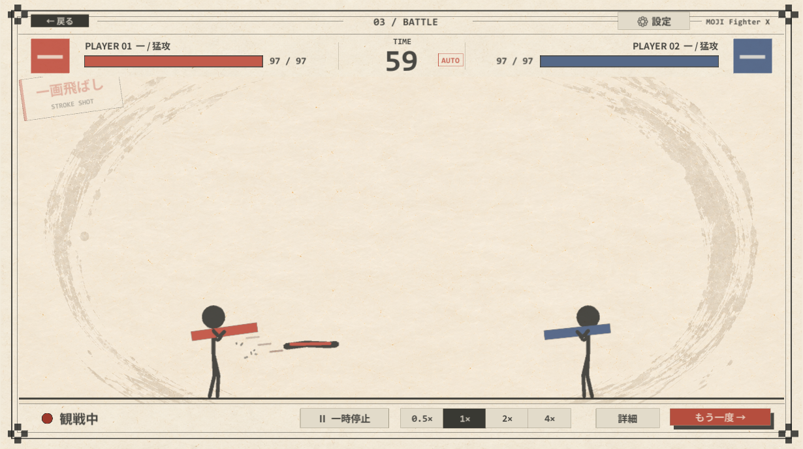

# 遠距離攻撃の追加（2026-10-08）

## 実装した技

| 技 | 使用する選手 | 動作 | 対処 | 射程 / 移動速度 / クールダウン |
| --- | --- | --- | --- | --- |
| 衝撃波 / GROUND WAVE | カスタマイズ武器L・XL、既定武器の重量級 | 膝を曲げて垂直にジャンプし、下降しながら床へ武器を叩きつける。武器が実際に床へ接触した位置から、床を這う波を放つ | ジャンプで跳び越える。正面の低いガードでも防げる | 9.5 / 6.5 / 5.5秒 |
| 一画飛ばし / STROKE SHOT | カスタマイズ武器S・M、既定武器の軽量・中量級 | 武器を振って短い墨の筆線を直線に飛ばす。武器は手に保持する | 正面ガードで防ぐ | 7.5 / 9 / 3.2秒 |

衝撃波は0.22秒の踏み切り予備動作、目標頂点0.8のジャンプ、発射後0.8秒の硬直。一画飛ばしは0.28秒の予備動作、発射後0.38秒の硬直。1発のダメージは通常の能力値・防御式を使い、相手最大HPの22% / 15%を上限にする。

## AI・当たり判定・演出

- 近接射程の外、距離3以上で使用する。既定の選択確率はAI判断1回あたり3.5%。既存の近接技・投げの選択肢を維持する。
- 遠距離技を出すかどうかの乱数は試合seedと選手IDから作る独立した系列を使う。新技を出さなかった場合に近接AIの乱数を余計に消費しない。
- 飛び道具への反応は、持ち主の現在の技と独立して判定する。AIは衝撃波をジャンプ、筆線をガードで対処する。
- 弾は試合の固定時計で移動する。移動の区間全体で本体との重なりを確認し、高速な弾のすり抜けを防ぐ。
- 発射時の技と攻撃IDを保持するため、次の攻撃が始まっても当たりが混ざらない。攻撃台帳で1発につき1回の命中・ガードを保証する。
- 武器本体には遠距離技中の近接ダメージ判定を持たせない。床接触前の中断では波を生成しない。射程・壁・試合終了で弾を消す。
- 墨と陣営色で筆線・波・短い尾を描く。技名を現在のHUDへ表示し、衝撃波には床の墨飛沫・揺れ・叩きつけ音、一画飛ばしには斬撃音を付ける。
- 調整項目は `CombatBalance` の「遠距離攻撃」欄。

## 確認結果

Unity 6000.0.61f1。元のUnityプロジェクトとは別の検証用コピーで、PlayModeの関連テスト39件すべて成功。

新規 `RangedAttackTests` 10件:

- 一画飛ばしの単発命中と、持ち主が別の攻撃を始めた後の攻撃ID維持。
- 一画飛ばしの正面ガード。
- 衝撃波のジャンプ、実際の床接触、単発命中、動作終了。検証時の頂点0.98、武器の床接触Y=0.01。
- 実際のジャンプ回避。
- 床接触前の被弾中断で波が出ないこと。
- 使用サイズの制約、クールダウン、射程外の消滅。
- 移動速度500でも本体をすり抜けずに一度当たること。
- AIによる両技の選択。
- 両技の実画面描画と発射時の効果音。
- 同一seedで発射順・攻撃ID・時刻・残HPが再現すること。

関連回帰: `CloseCombatTests`、`UnarmedPressureTests`、`ExpandedActionTests`、`NewTechniqueTests`、`SeedReproducibilityTests`、武器保持のP0検証。旧技名表示テストは、以前のTextMeshから現在のHUDの `TechniqueName` に更新した。

大型文字6組の停止時間は最長1.28秒（1.5秒未満）、既定武器の握り誤差は最大0.131（0.2未満）。

結果: `ranged-regression-tests.xml` / `ranged-regression-tests.log`。

